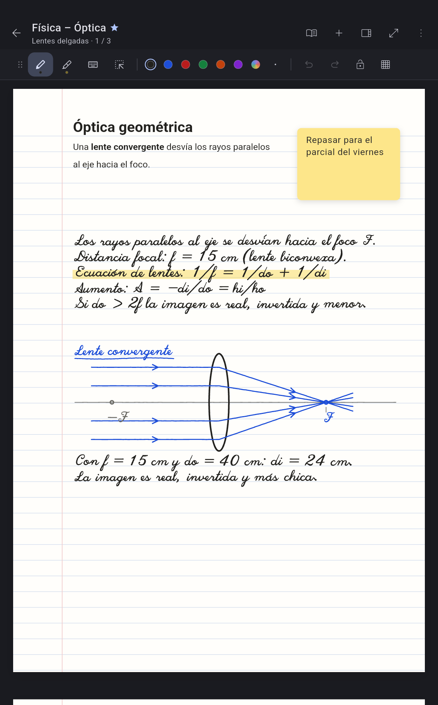

# OpenNote

**Tomá apuntes a mano en tu tablet, libre y sin ataduras.**

## ¿Qué es?

OpenNote es una app de apuntes a mano con S Pen (y también con teclado) para tablets Android. Nació
como alternativa a Samsung Notes, que solo funciona en Samsung y no te deja usar tus apuntes en otro
lado. OpenNote es gratis, es de código abierto, funciona sin conexión y tus apuntes son tuyos: se
guardan en tu tablet, sin cuentas ni servidores.

## Funciones

**Escritura**

- Escribí con el lápiz y la presión se nota en el trazo.
- Varias puntas, colores y grosores, y resaltador.
- Borrá apretando el botón del S Pen.
- Con el dedo te desplazás, pellizcás para hacer zoom, y podés bloquear el zoom.
- Escribí con teclado cuando lo necesites: tocá el tecladito y se abre un renglón nuevo, con negrita, cursiva, colores, títulos, listas y alineación.
- Seleccioná con un recuadro: arrastrando hacia la derecha tomás lo que queda adentro; hacia la izquierda, todo lo que el recuadro toca. Después podés mover, copiar, duplicar o eliminar.
- Cambiá el orden de lo seleccionado: traerlo al frente o enviarlo al fondo.
- Insertá imágenes, notas adhesivas y grabaciones de voz.

**Cuadernos**

- Cada cuaderno es una tira continua de hojas A4: deslizás de una a otra, y el título muestra cuál
  estás viendo (por ejemplo, "2 / 5").
- En el panel de hojas podés agregar, duplicar, mover, borrar, marcar o renombrar cada hoja.
- Fondos rayado, cuadriculado o de puntos, con medidas reales de A4: si imprimís al 100 %, sale a
  tamaño real.
- Elegí el estilo de una hoja o de todo el cuaderno.
- Marcá cuadernos como favoritos y protegelos con un PIN.
- Modo lectura, para leer sin tocar nada por error.
- La barra de herramientas se puede acomodar a tu gusto.

**Biblioteca**

- Organizá tus cuadernos en carpetas, dentro de otras carpetas.
- Buscá cuadernos y carpetas por nombre, sin importar mayúsculas ni tildes.

**Archivos**

- Importá PDF, imágenes y audios.
- Exportá tus cuadernos a PDF o PNG.

**Aspecto**

- Sigue el tema de tu tablet, con los colores de Material You.

## Capturas

*Un cuaderno abierto: escritura a mano con presión, texto con teclado, resaltador, diagramas y notas adhesivas.*

*El panel de hojas, con miniaturas para saltar, mover o marcar cada una.*

*La biblioteca: carpetas, favoritos y miniaturas de tus cuadernos.*

## Instalación

Por ahora, la forma más fácil es bajar el APK desde la página de
[Releases](https://github.com/santiagofr1/OpenNote/releases):

1. Descargá el archivo `.apk` de la última versión.
2. Abrilo desde tu tablet. Si Android lo pide, habilitá **"Instalar apps desconocidas"** para el
   navegador o el gestor de archivos que uses.
3. Seguí los pasos del instalador.

Si preferís compilarlo vos mismo, mirá la guía en [CONTRIBUTING.md](CONTRIBUTING.md).

## Compatibilidad

OpenNote fue probado en una **Samsung Galaxy Tab S6 Lite (SM-P620) con Android 16** y el S Pen.

Debería funcionar en otras tablets Android con lápiz activo, como la gama Galaxy Tab S o tablets con
lápiz USI, pero todavía no las probamos. Si tenés una y la probás, contanos en un issue: nos sirve
mucho saber qué anda y qué no.

## ¿Querés ayudar?

Cualquier ayuda es bienvenida.

- **Reportar un error o proponer una idea:** abrí un issue desde
  [Nuevo issue](https://github.com/santiagofr1/OpenNote/issues/new/choose). Hay plantillas para
  reportar un error y para proponer una mejora.
- **Mandar código:** leé [CONTRIBUTING.md](CONTRIBUTING.md) y después abrí un Pull Request.
- **Entender cómo está hecho por dentro:** la documentación técnica está en
  [docs/TECNICO.md](docs/TECNICO.md).

## Licencia

OpenNote es software libre bajo la [licencia MIT](LICENSE). Podés usarlo, modificarlo y compartirlo.
