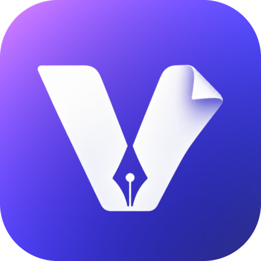
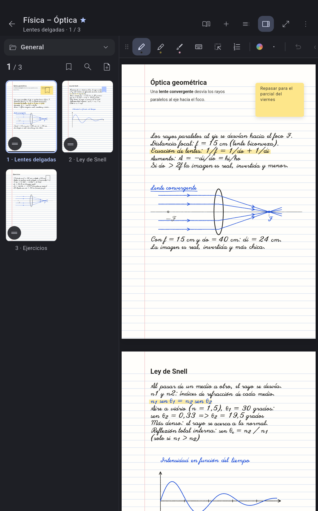
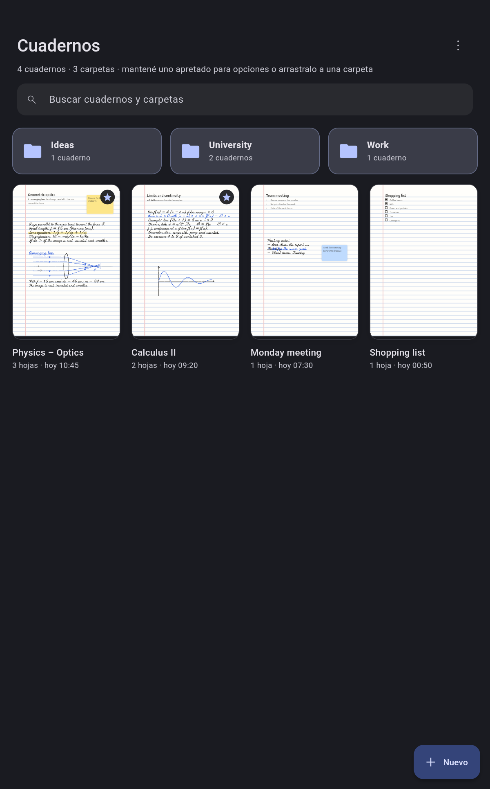
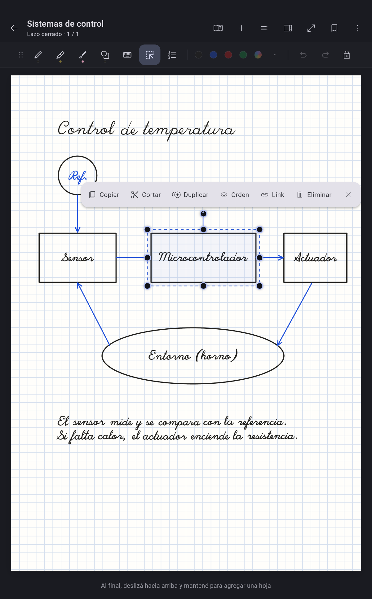
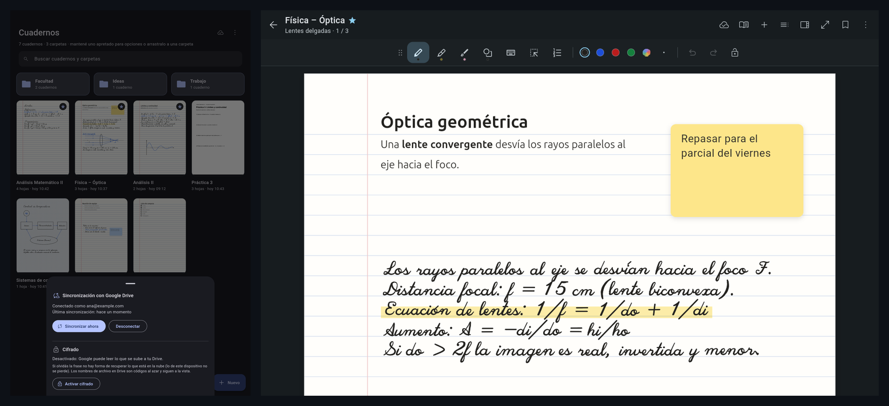

<p align="center"></p>

# Vynote

**Take handwritten notes on your tablet, free and without strings attached.**

[](https://github.com/santiagofr1/Vynote/releases/latest)
[](https://github.com/santiagofr1/Vynote/actions/workflows/release.yml)
[](LICENSE)
[](CONTRIBUTING.md)
[](https://github.com/santiagofr1/Vynote/releases/latest)
[](https://flutter.dev)

Vynote is a note-taking app for writing by hand on Android tablets, with a pen like the S Pen, and with the keyboard
when you need it. It's free and open source, it works offline, and your notes stay yours: they live on your device, with
no accounts and no servers of ours. If you want, your own Google Drive keeps the tablet and your PC in sync.

It's available in English, Spanish and Brazilian Portuguese.

## What it solves

- **Your notes are on the tablet, but you study or work on the PC.** The same notebooks open in the Linux and Windows
  app, and they sync on their own through your own Google Drive.
- **You don't want to hand your notes to someone else's server.** There are no accounts or servers of ours: everything
  stays on your devices and in your Drive, and with end-to-end encryption not even Google can read it.
- **You can't find that topic in a 60-page notebook.** Mark your handwritten titles and the index numbers them and takes
  you straight to each one.
- **You have to study from a PDF or a worksheet.** Import it and write, highlight and answer right on top, on the
  tablet or on the PC.
- **Your sketches and diagrams come out messy.** Draw a shape, hold the pen still, and it turns into a neat line,
  circle, rectangle or polygon.
- **You need to move or back up a notebook.** Export it as PDF, PNG or a `.vynote` file and take it to another
  device.

## Features

**Writing and drawing**
- Ink that responds to pen pressure, with several pen tips, a highlighter and your own colors.
- Neat shapes: draw roughly, hold the pen still, and it snaps into a clean shape you can still resize.
- The pen button erases, so you never have to switch tools.
- Typed text with the usual formatting (headings, lists, bold, colors) next to your handwriting.
- Images, sticky notes and voice recordings on the page.

**Editing**
- Select anything with a box or a tap, then move, resize, rotate, copy or reorder it.
- Every change can be undone, including adding, moving or deleting pages.

**Finding your way**
- An index built from your handwritten titles, numbered by level, that takes you to each one.
- A page panel with thumbnails to jump around, bookmark and reorder pages.
- Search across typed text, sticky notes and page titles.
- A library with nested folders, favorites and PIN-locked notebooks.

**Paper**
- Ruled, grid, dotted and plain backgrounds, plus templates (Cornell, to-do list, music staff, planners), all at real
  paper size, so they print to scale.
- Your own templates from any image, and a style per page or for the whole notebook.
- An infinite canvas when a page isn't enough.

**PDFs**
- Import a PDF and write, highlight and answer right on top of it.
- Export notebooks as PDF or PNG, or as a `.vynote` file to back them up or move them; whole folders export and import
  as a `.zip`.

**Sync and PC**
- Optional Google Drive sync between the tablet and the Linux and Windows apps, merged page by page.
- End-to-end encryption with a passphrase, so only your devices can read your notes.
- On the PC: zoom with Ctrl + mouse wheel and keyboard shortcuts (Ctrl+/ lists them).

**Made to read and present**
- Reading mode to go through your notes without touching anything by mistake, and full screen.
- A Material You look that follows your tablet's theme, and works on phones too.

## Screenshots

<table>
  <tr>
    <td align="center"><br><sub><b>Notebook</b>: handwriting with pressure, keyboard text, highlighter and notes.</sub></td>
    <td align="center"><br><sub><b>Page panel</b>: thumbnails to jump to, move or mark each page.</sub></td>
    <td align="center"><br><sub><b>Library</b>: folders, favorites and thumbnails of your notebooks.</sub></td>
  </tr>
  <tr>
    <td align="center"><br><sub><b>Index</b>: handwritten titles numbered by level, with the panel to jump to each one.</sub></td>
    <td align="center"><br><sub><b>Shapes and selection</b>: neat shapes made from your strokes, with handles to stretch and rotate.</sub></td>
    <td align="center"><br><sub><b>Annotated PDF</b>: an imported PDF with highlighting and handwritten answers on top.</sub></td>
  </tr>
  <tr><td colspan="3" align="center"><br><sub><b>Tablet and PC in sync</b>: the same notebook on the tablet and in the Linux app, with Google Drive.</sub></td></tr>
</table>

## Installation

### From the APK (easiest)

1. Download the `.apk` file from the [latest release](https://github.com/santiagofr1/Vynote/releases/latest).
2. Open it on your tablet. If Android asks, enable **Install unknown apps** for the browser
   or file manager you use.
3. Follow the installer's steps.

The app updates itself: when you open it, it looks for a new version on GitHub, shows you what's new, and asks whether
you want to install it. It never touches your notebooks.

> If you already installed a version you compiled yourself (signed with the debug key), the first release signed with
> the official key can't be installed on top of it. Back up your notebooks, uninstall Vynote once, and install the APK.
> After that, updates work normally. Details in [docs/RELEASES.md](docs/RELEASES.md).

### On Linux (Debian/Ubuntu)

Using the apt repo (updated with `apt upgrade`):

```sh
sudo install -d -m 0755 /etc/apt/keyrings
curl -fsSL https://santiagofr1.github.io/apt/key.asc | sudo gpg --dearmor -o /etc/apt/keyrings/santiagofr1.gpg
echo "deb [signed-by=/etc/apt/keyrings/santiagofr1.gpg] https://santiagofr1.github.io/apt stable main" | sudo tee /etc/apt/sources.list.d/santiagofr1.list
sudo apt update
sudo apt install vynote
```

Or by downloading the `.deb` from the [latest release](https://github.com/santiagofr1/Vynote/releases/latest):

```sh
sudo apt install ./vynote_<version>_amd64.deb
```

Then open it from the applications menu or with `vynote`. To build the `.deb` yourself: `tool/build_deb.sh <version>`.

### On Windows

Download `Vynote-v<version>-windows-setup.exe` from the [latest release](https://github.com/santiagofr1/Vynote/releases/latest)
and run it (Windows 10 or 11, 64-bit). It installs to `Program Files\Vynote`, creates a Start menu shortcut (and a
desktop one if you choose), and uninstalls from **Installed apps**. The installer comes out
a few minutes after the APK and is not signed: Windows SmartScreen may warn you, so pick **More info**
and then **Run anyway**. No background sync (same as Linux); Google login opens your browser.

### From the source

You need [Flutter](https://flutter.dev) on the *stable* channel:

```sh
git clone https://github.com/santiagofr1/Vynote
cd Vynote
flutter pub get
flutter run                # on a connected tablet or emulator
flutter build apk          # builds the APK into build/app/outputs/flutter-apk/
```

To build for the tablet you also need the Android SDK and JDK 21. The full steps are in
[CONTRIBUTING.md](CONTRIBUTING.md).

## Usage

- **Write** with the pen. Your finger scrolls the page and pinches to zoom; lock the zoom if it gets in the way.
- **Erase** by holding the pen button while you go over the ink.
- **Type** with the keyboard icon in the toolbar.
- **Add a page** by dragging up past the end of the last one and holding until the circle fills.
- **On the PC**, hold Ctrl and turn the mouse wheel to zoom; the wheel alone scrolls.
- **Organize** from the library: **+** creates a notebook or a folder, and pressing and holding one gives you
  **Move to…**, **Export** and more.
- **Settings** (in the library's ⋮ menu) has the app language, the handwriting language and the version.

## Compatibility

Vynote was tested on a **Samsung Galaxy Tab S6 Lite (SM-P620) with Android 16** and the S Pen.

It should work on other Android tablets with an active pen, like the Galaxy Tab S line or tablets with USI pens, but we
haven't tested those yet. If you have one and try it, let us know in an issue: it really helps to know what works and
what doesn't.

## How it's built

```
lib/
├── domain/      # pure data, no Flutter: pages, strokes, z-order, meshes, notebooks, folders, tools
├── data/        # per-page storage (binary + zlib), background saving, lazy loading, export
├── rendering/   # stroke drawing as meshes, paper, page images in strips
├── editor/      # editor, tools, selection, history, text, zoom, toolbar
├── screens/     # library, open notebook, page panel, search and menus
├── widgets/     # dialogs and shared pieces
└── theme/       # theme and colors
integration_test/  # full tablet suite (app_test.dart)
tool/              # scripts: screenshots, icon, traces
docs/              # releases, screenshots and icon
```

Each layer only uses the ones above it: `domain` knows nothing about Flutter, and the rest build on top of it.

## Contributing

Vynote is **free software** under the GPL v3 or later. You can use, copy, modify and redistribute it, as long as
whatever you distribute stays free.

Free software works because people dive in. You don't need to be a Flutter expert or ask for permission:

- **Fork it** and make your own version: another palette, other pen tips, another page style. If something cool comes out of it, tell us.
- **Send a PR**, however small. Fixing a text, adding a background or running a test counts too.
- **Open an issue** if something doesn't work on your tablet or with your pen. With so many different models and brands,
  your report is what makes it work for everyone.
- **Suggest ideas**: [New issue](https://github.com/santiagofr1/Vynote/issues/new/choose) has templates for reporting
  a bug and proposing an improvement.

Some good first contributions:

- [ ] Try Vynote on another tablet or with another pen (USI, newer Galaxy Tab S) and report what works
- [ ] Translate Vynote into your language (one `.arb` file in `lib/l10n/`; see [CONTRIBUTING.md](CONTRIBUTING.md))
- [ ] New page backgrounds or templates (`lib/domain/paper_layout.dart`, `lib/widgets/backgrounds.dart`)
- [ ] New pen tips (`lib/domain/tools.dart`, drawing in `lib/domain/stroke_mesh.dart`)
- [ ] F-Droid packaging
- [ ] PC app: Linux (.deb) and Windows (.exe) are already there; macOS is missing, along with mouse and graphics tablet input, shortcuts and packaging
- [ ] More pure-logic tests in `test/`

The contributing guide is in [CONTRIBUTING.md](CONTRIBUTING.md).

## License

[GPL v3 or later](LICENSE) © 2026 Santiago Frances. You may use, study, modify and redistribute the code. If you
distribute a modified version, it must use the same license and ship its source code.
