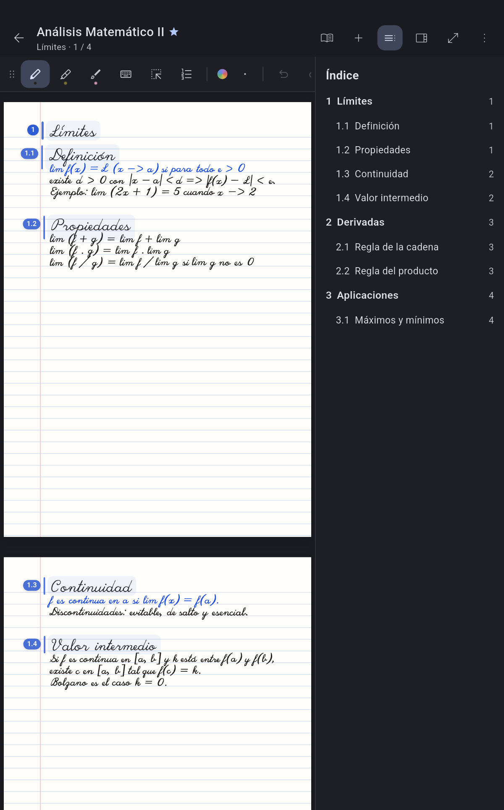

# OpenNote

**Tomá apuntes a mano en tu tablet, libre y sin ataduras.**

[](https://github.com/santiagofr1/OpenNote/releases/latest)
[](https://github.com/santiagofr1/OpenNote/actions/workflows/release.yml)
[](LICENSE)
[](CONTRIBUTING.md)
[](https://github.com/santiagofr1/OpenNote/releases/latest)
[](https://flutter.dev)

OpenNote es una app de apuntes a mano con S Pen (y también con teclado) para tablets Android.
Es gratis, es de código abierto, funciona sin conexión y tus apuntes son tuyos: se guardan en tu dispositivo,
sin cuentas ni servidores propios. Si querés, los sincronizás entre la tablet y la PC con tu propio Google Drive.

## Qué tiene

- **Escritura con presión**: el trazo engrosa o se afina según cuánto apretás el lápiz.
- **Puntas y colores**: bolígrafo, pluma, lápiz, fibra y caligrafía, más resaltador, con paleta propia y grosores a elección.
- **Figuras inteligentes**: dibujás una recta, círculo, elipse, rectángulo/cuadrado, triángulo o polígono, dejás el
  lápiz quieto un instante y se vuelve una figura prolija; sin levantar el lápiz la agrandás o achicás. Se activa o
  desactiva en el panel del lápiz.
- **Borrador en el botón**: apretá el botón del S Pen para borrar. Hay tres tamaños de goma.
- **Texto con formato**: tocá el tecladito y se abre un renglón nuevo con negrita, cursiva, subrayado, colores,
  títulos, listas, sangría y alineación.
- **Índice del cuaderno**: con la herramienta Título encerrás lo que escribiste (a mano o con teclado) y lo marcás
  como Título 1, 2, 3…; la letra a mano se lee sola, sin internet. El panel Índice muestra todo numerado (1, 1.1,
  1.2…) con el número de hoja y te lleva a cada título; los títulos marcados se ven en la hoja con su número y viajan
  con la sincronización.
- **Selección tipo AutoCAD**: arrastrando hacia la derecha tomás lo que queda adentro del recuadro; hacia la
  izquierda, todo lo que el recuadro toca. Un toque elige un solo elemento y tocar de nuevo alterna al de abajo (por
  ejemplo, solo el resaltador de una palabra); tocar afuera deselecciona. Dejando el dedo apretado sobre la hoja, "Seleccionar todo" toma lo de esa hoja y
  "Seleccionar todo el cuaderno" carga y toma todas. Después podés mover, copiar, duplicar o eliminar. Las esquinas escalan manteniendo la proporción y los puntos del medio de cada lado estiran solo a lo ancho o solo a lo alto; también se puede rotar.
- **Orden de capas**: traer al frente, subir, bajar o enviar al fondo lo seleccionado. Se puede deshacer.
- **Imágenes, notas adhesivas y audios**: insertalos dentro de la hoja, junto con la tinta.
- **Cuadernos como tira de hojas**: deslizás de una hoja a otra y el título muestra cuál estás viendo (por
  ejemplo, "2 / 5"). Agregá, duplicá, borrá, marcá o renombrá hojas desde el panel de miniaturas, y reordenalas
  arrastrando el asa. Todo eso se puede deshacer.
- **Fondos en medidas reales de A4**: rayado de 7, 8 o 10 mm, cuadriculado o puntos. Si imprimís al 100 %, sale a
  tamaño real.
- **Estilo por hoja o por cuaderno**: elegí el fondo, el color de papel y el interlineado.
- **Biblioteca ordenada**: carpetas anidadas, favoritos, búsqueda por nombre sin importar mayúsculas ni tildes,
  y cuadernos protegidos con PIN.
- **Modo lectura**: para leer sin tocar nada por error.
- **Exportar e importar**: con una sola opción "Exportar" sacás cuadernos a PDF o PNG, o enteros como archivo `.opennote` para respaldarlos o
  pasarlos a otra tablet; importá `.opennote`, PDF, imágenes y audios. Un PDF importado entra en la hoja que estás viendo y sus páginas se abren al instante, listas para escribir encima.
- **Sincronización con Google Drive (opcional)**: te conectás una vez con tu cuenta de Google y la tablet y la app de PC (Linux y Windows) quedan sincronizadas solas. La app solo ve su propia carpeta "OpenNote" en tu Drive, los cambios hechos en dos dispositivos se combinan hoja por hoja, y podés activar cifrado de extremo a extremo con una frase para que nadie más pueda leer tus apuntes, ni siquiera Google.
- **App de PC**: la misma app para Linux y Windows, con tus cuadernos sincronizados; se instala desde el repo apt o el instalador (ver Instalación).
- **Aspecto Material You**: sigue el tema de tu tablet.

## Capturas

<table>
  <tr>
    <td align="center"><br><sub><b>Cuaderno</b>: escritura a mano con presión, texto con teclado, resaltador y notas.</sub></td>
    <td align="center"><br><sub><b>Panel de hojas</b>: miniaturas para saltar, mover o marcar cada hoja.</sub></td>
    <td align="center"><br><sub><b>Biblioteca</b>: carpetas, favoritos y miniaturas de tus cuadernos.</sub></td>
  </tr>
  <tr>
    <td align="center"><br><sub><b>Índice</b>: títulos a mano numerados por niveles, con el panel para saltar a cada uno.</sub></td>
    <td align="center"><br><sub><b>Figuras y selección</b>: figuras prolijas a partir del trazo, con manijas para estirar y rotar.</sub></td>
    <td align="center"><br><sub><b>PDF anotado</b>: un PDF importado con resaltador y respuestas a mano encima.</sub></td>
  </tr>
  <tr><td colspan="3" align="center"><br><sub><b>Tablet y PC sincronizadas</b>: el mismo cuaderno en la tablet y en la app de Linux, con Google Drive.</sub></td></tr>
</table>

## Instalación

### Desde el APK (lo más fácil)

1. Bajá el archivo `.apk` de la [última release](https://github.com/santiagofr1/OpenNote/releases/latest).
2. Abrilo desde tu tablet. Si Android lo pide, habilitá **"Instalar apps desconocidas"** para el navegador o el
   gestor de archivos que uses.
3. Seguí los pasos del instalador.

La app se actualiza sola: al abrirla busca una versión nueva en GitHub, te muestra las novedades y te pregunta si
querés instalarla. Nunca toca tus cuadernos.

> Si ya instalaste una versión compilada por vos (firmada con la clave de debug), la primera release firmada con la
> clave oficial no se puede instalar encima. Hacé un backup de tus cuadernos, desinstalá OpenNote una vez e instalá
> el APK. Después, las actualizaciones son normales. Detalles en [docs/RELEASES.md](docs/RELEASES.md).

### En Linux (Debian/Ubuntu)

Con el repo apt (se actualiza con `apt upgrade`):

```sh
sudo install -d -m 0755 /etc/apt/keyrings
curl -fsSL https://santiagofr1.github.io/apt/key.asc | sudo gpg --dearmor -o /etc/apt/keyrings/santiagofr1.gpg
echo "deb [signed-by=/etc/apt/keyrings/santiagofr1.gpg] https://santiagofr1.github.io/apt stable main" | sudo tee /etc/apt/sources.list.d/santiagofr1.list
sudo apt update
sudo apt install opennote
```

O bajando el `.deb` de la [última release](https://github.com/santiagofr1/OpenNote/releases/latest):

```sh
sudo apt install ./opennote_<versión>_amd64.deb
```

Después lo abrís desde el menú de aplicaciones o con `opennote`. Para armar el `.deb` vos mismo: `tool/build_deb.sh <versión>`.

### En Windows

Bajá `OpenNote-v<versión>-windows-setup.exe` de la [última release](https://github.com/santiagofr1/OpenNote/releases/latest)
y ejecutalo (Windows 10 u 11, 64 bits). Instala en `Program Files\OpenNote`, crea el acceso directo en el menú inicio
(y en el escritorio si lo elegís) y se desinstala desde "Aplicaciones instaladas". El instalador sale unos minutos
después del APK y no está firmado: Windows SmartScreen puede avisar, "Más información" y "Ejecutar de todas formas".
Sin sincronización en segundo plano (como en Linux); el login de Google abre el navegador.

### Desde el código

Necesitás [Flutter](https://flutter.dev) en canal *stable*:

```sh
git clone https://github.com/santiagofr1/OpenNote
cd OpenNote
flutter pub get
flutter run                # en una tablet o emulador conectado
flutter build apk          # genera el APK en build/app/outputs/flutter-apk/
```

Para compilar para la tablet hacen falta también el Android SDK y JDK 21. Los pasos completos están en
[CONTRIBUTING.md](CONTRIBUTING.md).

## Uso

- **Escribir**: usá el S Pen para escribir. Con el dedo te desplazás por la hoja, y pellizcás para hacer zoom.
  Podés bloquear el zoom si te molesta.
- **Borrar**: apretá el botón del S Pen mientras pasás la punta por la tinta.
- **Texto**: tocá el tecladito de la barra para abrir un renglón nuevo y escribir con teclado.
- **Hojas**: deslizá entre hojas. Al final de la página, tirá hacia arriba y mantené hasta que se llene el círculo
  para agregar una hoja nueva. El panel de hojas te muestra todas en miniatura.
- **Cuadernos**: desde la biblioteca, el "+" crea un cuaderno nuevo (en la carpeta en la que estás) o una carpeta.
  Mantené apretado un cuaderno o una carpeta para elegir "Mover a…".

## Compatibilidad

OpenNote fue probado en una **Samsung Galaxy Tab S6 Lite (SM-P620) con Android 16** y el S Pen.

Debería funcionar en otras tablets Android con lápiz activo, como la gama Galaxy Tab S o tablets con lápiz USI,
pero todavía no las probamos. Si tenés una y la probás, contanos en un issue: sirve mucho saber qué anda y qué no.

## Cómo está armado

```
lib/
├── domain/      # datos puros, sin Flutter: hojas, trazos, z-order, mallas, cuadernos, carpetas, herramientas
├── data/        # almacenamiento por hoja (binario + zlib), guardado en segundo plano, carga perezosa, export
├── rendering/   # dibujo de trazos como mallas, papel, imágenes de hojas por franjas
├── editor/      # editor, herramientas, selección, historial, texto, zoom, barra
├── screens/     # biblioteca, cuaderno abierto, panel de hojas, búsqueda y menús
├── widgets/     # diálogos y piezas compartidas
└── theme/       # tema y colores
integration_test/  # suite completa en tablet (app_test.dart)
tool/              # scripts: capturas, ícono, trazas
docs/              # releases, capturas e ícono
```

Cada capa usa solo las de arriba: `domain` no sabe nada de Flutter, y el resto se apoya en él.

## Contribuir

OpenNote es **software libre** bajo licencia GPL v3. Lo podés usar, copiar, modificar y redistribuir, siempre que lo que distribuyas siga siendo libre.

El software libre funciona porque la gente se anima a meter mano. No hace falta ser experto en Flutter ni pedir permiso:

- **Forkealo** y hacé tu propia versión: otra paleta, otras puntas, otro estilo de hoja. Si sale algo lindo, contalo.
- **Mandá un PR**, por chico que sea. Arreglar un texto, sumar un fondo o probar un test cuenta igual.
- **Abrí un issue** si algo no anda en tu tablet o con tu lápiz. Con tantos modelos y marcas distintas, tu reporte
  es lo que hace que funcione para todos.
- **Proponé ideas**: [Nuevo issue](https://github.com/santiagofr1/OpenNote/issues/new/choose) tiene plantillas para
  reportar un error y para proponer una mejora.

Algunas buenas primeras contribuciones:

- [ ] Probar OpenNote en otra tablet o con otro lápiz (USI, Galaxy Tab S más nueva) y reportar qué anda
- [ ] Traducción al inglés de los textos de la interfaz (hoy está todo en español)
- [ ] Nuevos fondos o plantillas de hoja (`lib/domain/paper_layout.dart`, `lib/widgets/backgrounds.dart`)
- [ ] Nuevas puntas para el lápiz (`lib/domain/tools.dart`, dibujo en `lib/domain/stroke_mesh.dart`)
- [ ] Empaquetado para F-Droid
- [ ] App de PC: ya hay Linux (.deb) y Windows (.exe); falta macOS, y resolver entrada con mouse y tableta, atajos y empaquetado
- [ ] Más tests de lógica pura en `test/`

La guía para arrancar está en [CONTRIBUTING.md](CONTRIBUTING.md).

## Licencia

[GPL v3](LICENSE) © 2026 Santiago Frances. Podés usar, estudiar, modificar y redistribuir el código. Si distribuís una versión
modificada, tiene que ser bajo la misma licencia y con su código fuente disponible.
