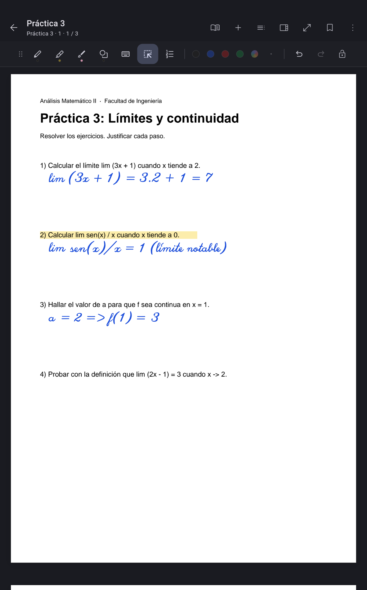

# OpenNote

**English** · [Español](README.es.md)

**Take handwritten notes on your tablet, free and without strings attached.**

[](https://github.com/santiagofr1/OpenNote/releases/latest)
[](https://github.com/santiagofr1/OpenNote/actions/workflows/release.yml)
[](LICENSE)
[](CONTRIBUTING.md)
[](https://github.com/santiagofr1/OpenNote/releases/latest)
[](https://flutter.dev)

OpenNote is a handwriting note-taking app with the S Pen (and with the keyboard too) for Android tablets.
It's free, it's open source, it works offline, and your notes are yours: they're stored on your device,
with no accounts and no servers of our own. If you want, you can sync them between your tablet and your PC with your own Google Drive.

## Features

- **Pressure-sensitive writing**: the stroke gets thicker or thinner depending on how hard you press the pen.
- **Tips and colors**: ballpoint, fountain pen, pencil, felt-tip and calligraphy, plus a highlighter, with its own palette and adjustable widths.
- **Smart shapes**: draw a line, circle, ellipse, rectangle/square, triangle or polygon, keep the pen still for a moment,
  and it turns into a neat shape. Without lifting the pen, you can stretch or shrink it. You can turn this on or off in the pen panel.
- **Eraser on the button**: press the S Pen button to erase. There are three eraser sizes.
- **Formatted text**: tap the keyboard icon and a new line opens with bold, italic, underline, colors,
  headings, lists, indentation and alignment.
- **Notebook index**: with the **"Título"** (Title) tool, you enclose what you wrote (by hand or with the keyboard) and mark it as
  Title 1, 2, 3… Handwriting is read on the spot, no internet needed. The **"Índice"** (Index) panel shows everything
  numbered (1, 1.1, 1.2…) with the page number and takes you to each title. Marked titles appear on the page with
  their number and travel with sync.
- **AutoCAD-style selection**: dragging to the right selects what's fully inside the box; dragging to the left selects
  everything the box touches. A tap selects a single item, and tapping again cycles to the one underneath (for example,
  only the highlighter on one word). Tapping outside deselects. Pressing and holding on the page, **"Seleccionar todo"**
  (Select all) takes everything on that page, and **"Seleccionar todo el cuaderno"** (Select entire notebook) loads and
  takes all of them. Then you can move, copy, duplicate or delete. Corner handles scale while keeping proportions, the
  handles in the middle of each side stretch only width or only height, and you can rotate.
- **Layer order**: bring to front, bring forward, send backward or send to back the selection. Can be undone.
- **Images, sticky notes and audio**: insert them on the page, alongside the ink.
- **Notebooks as a strip of pages**: swipe from page to page and the title shows which one you're on (for example,
  "2 / 5"). Add, duplicate, delete, mark or rename pages from the thumbnail panel, and reorder them by dragging the
  handle. All of that can be undone.
- **Backgrounds at real A4 size**: ruled at 7, 8 or 10 mm, grid or dots. If you print at 100 %, it comes out at actual size.
- **Style per page or per notebook**: choose the background, paper color and line spacing.
- **Organized library**: nested folders, favorites, name search that ignores case and accents, and notebooks protected with a PIN.
- **Reading mode**: read without touching anything by mistake.
- **Export and import**: with a single **"Exportar"** (Export) option, you can take notebooks out as PDF or PNG, or whole as an
  `.opennote` file to back them up or move them to another tablet. You can import `.opennote`, PDF, images and audio.
  An imported PDF goes into the page you're looking at, and its pages open instantly, ready to write on top of.
- **Google Drive sync (optional)**: connect once with your Google account, and the tablet and the PC apps (Linux and
  Windows) stay in sync on their own. The app only sees its own "OpenNote" folder in your Drive, changes made on two
  devices are merged page by page, and you can turn on end-to-end encryption with a passphrase so nobody else can read
  your notes, not even Google.
- **PC app**: the same app for Linux and Windows, with your synced notebooks. Install it from the apt repo or the
  installer (see Installation).
- **Material You look**: follows your tablet's theme.

## Screenshots

<table>
  <tr>
    <td align="center"><br><sub><b>Notebook</b>: handwriting with pressure, keyboard text, highlighter and notes.</sub></td>
    <td align="center"><br><sub><b>Page panel</b>: thumbnails to jump to, move or mark each page.</sub></td>
    <td align="center"><br><sub><b>Library</b>: folders, favorites and thumbnails of your notebooks.</sub></td>
  </tr>
  <tr>
    <td align="center"><br><sub><b>Index</b>: handwritten titles numbered by level, with the panel to jump to each one.</sub></td>
    <td align="center"><br><sub><b>Shapes and selection</b>: neat shapes made from your strokes, with handles to stretch and rotate.</sub></td>
    <td align="center"><br><sub><b>Annotated PDF</b>: an imported PDF with highlighting and handwritten answers on top.</sub></td>
  </tr>
  <tr><td colspan="3" align="center"><br><sub><b>Tablet and PC in sync</b>: the same notebook on the tablet and in the Linux app, with Google Drive.</sub></td></tr>
</table>

## Installation

### From the APK (easiest)

1. Download the `.apk` file from the [latest release](https://github.com/santiagofr1/OpenNote/releases/latest).
2. Open it on your tablet. If Android asks, enable **"Instalar apps desconocidas"** (Install unknown apps) for the browser
   or file manager you use.
3. Follow the installer's steps.

The app updates itself: when you open it, it looks for a new version on GitHub, shows you what's new, and asks whether
you want to install it. It never touches your notebooks.

> If you already installed a version you compiled yourself (signed with the debug key), the first release signed with
> the official key can't be installed on top of it. Back up your notebooks, uninstall OpenNote once, and install the APK.
> After that, updates work normally. Details in [docs/RELEASES.md](docs/RELEASES.md).

### On Linux (Debian/Ubuntu)

Using the apt repo (updated with `apt upgrade`):

```sh
sudo install -d -m 0755 /etc/apt/keyrings
curl -fsSL https://santiagofr1.github.io/apt/key.asc | sudo gpg --dearmor -o /etc/apt/keyrings/santiagofr1.gpg
echo "deb [signed-by=/etc/apt/keyrings/santiagofr1.gpg] https://santiagofr1.github.io/apt stable main" | sudo tee /etc/apt/sources.list.d/santiagofr1.list
sudo apt update
sudo apt install opennote
```

Or by downloading the `.deb` from the [latest release](https://github.com/santiagofr1/OpenNote/releases/latest):

```sh
sudo apt install ./opennote_<version>_amd64.deb
```

Then open it from the applications menu or with `opennote`. To build the `.deb` yourself: `tool/build_deb.sh <version>`.

### On Windows

Download `OpenNote-v<version>-windows-setup.exe` from the [latest release](https://github.com/santiagofr1/OpenNote/releases/latest)
and run it (Windows 10 or 11, 64-bit). It installs to `Program Files\OpenNote`, creates a Start menu shortcut (and a
desktop one if you choose), and uninstalls from **"Aplicaciones instaladas"** (Installed apps). The installer comes out
a few minutes after the APK and is not signed: Windows SmartScreen may warn you, so pick **"Más información"** (More info)
and then **"Ejecutar de todas formas"** (Run anyway). No background sync (same as Linux); Google login opens your browser.

### From the source

You need [Flutter](https://flutter.dev) on the *stable* channel:

```sh
git clone https://github.com/santiagofr1/OpenNote
cd OpenNote
flutter pub get
flutter run                # on a connected tablet or emulator
flutter build apk          # builds the APK into build/app/outputs/flutter-apk/
```

To build for the tablet you also need the Android SDK and JDK 21. The full steps are in
[CONTRIBUTING.md](CONTRIBUTING.md).

## Usage

- **Writing**: use the S Pen to write. With your finger you scroll across the page, and pinch to zoom.
  You can lock the zoom if it bothers you.
- **Erasing**: press the S Pen button while moving the tip over the ink.
- **Text**: tap the keyboard icon in the toolbar to open a new line and type with the keyboard.
- **Pages**: swipe between pages. At the end of the last page, drag up and hold until the circle fills to add a new
  page. The page panel shows all of them as thumbnails.
- **Notebooks**: from the library, the "+" creates a new notebook (in the folder you're in) or a new folder. Press and
  hold a notebook or folder to choose **"Mover a…"** (Move to…).

## Compatibility

OpenNote was tested on a **Samsung Galaxy Tab S6 Lite (SM-P620) with Android 16** and the S Pen.

It should work on other Android tablets with an active pen, like the Galaxy Tab S line or tablets with USI pens, but we
haven't tested those yet. If you have one and try it, let us know in an issue: it really helps to know what works and
what doesn't.

## How it's built

```
lib/
├── domain/      # pure data, no Flutter: pages, strokes, z-order, meshes, notebooks, folders, tools
├── data/        # per-page storage (binary + zlib), background saving, lazy loading, export
├── rendering/   # stroke drawing as meshes, paper, page images in strips
├── editor/      # editor, tools, selection, history, text, zoom, toolbar
├── screens/     # library, open notebook, page panel, search and menus
├── widgets/     # dialogs and shared pieces
└── theme/       # theme and colors
integration_test/  # full tablet suite (app_test.dart)
tool/              # scripts: screenshots, icon, traces
docs/              # releases, screenshots and icon
```

Each layer only uses the ones above it: `domain` knows nothing about Flutter, and the rest build on top of it.

## Contributing

OpenNote is **free software** under the GPL v3 or later. You can use, copy, modify and redistribute it, as long as
whatever you distribute stays free.

Free software works because people dive in. You don't need to be a Flutter expert or ask for permission:

- **Fork it** and make your own version: another palette, other pen tips, another page style. If something cool comes out of it, tell us.
- **Send a PR**, however small. Fixing a text, adding a background or running a test counts too.
- **Open an issue** if something doesn't work on your tablet or with your pen. With so many different models and brands,
  your report is what makes it work for everyone.
- **Suggest ideas**: [New issue](https://github.com/santiagofr1/OpenNote/issues/new/choose) has templates for reporting
  a bug and proposing an improvement.

Some good first contributions:

- [ ] Try OpenNote on another tablet or with another pen (USI, newer Galaxy Tab S) and report what works
- [ ] Translate the interface text into English (right now everything is in Spanish)
- [ ] New page backgrounds or templates (`lib/domain/paper_layout.dart`, `lib/widgets/backgrounds.dart`)
- [ ] New pen tips (`lib/domain/tools.dart`, drawing in `lib/domain/stroke_mesh.dart`)
- [ ] F-Droid packaging
- [ ] PC app: Linux (.deb) and Windows (.exe) are already there; macOS is missing, along with mouse and graphics tablet input, shortcuts and packaging
- [ ] More pure-logic tests in `test/`

The contributing guide is in [CONTRIBUTING.md](CONTRIBUTING.md).

## License

[GPL v3 or later](LICENSE) © 2026 Santiago Frances. You may use, study, modify and redistribute the code. If you
distribute a modified version, it must use the same license and ship its source code.
